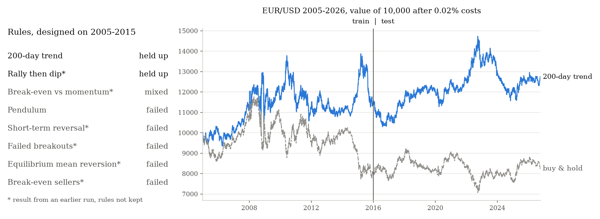

# Backtester

[](https://github.com/ron-btnk/Backtester/actions/workflows/tests.yml)

8 trading rules for EUR/USD, designed on 2005-2015 and tested on 2016-2026: 2 held up, 1 was mixed, 5 failed. Each rule is tested on years it was not designed on, against random strategies and with its numbers shifted.



**88%** of 300 random strategies with the same time in the market had a lower Sharpe ratio than the 200-day trend rule (263 of 300). Rally then dip has no benchmark because its rules were not kept.

Web app: https://backtester-rbtnk.streamlit.app/

<details>
<summary><b>Running it</b></summary>

Online: https://backtester-rbtnk.streamlit.app/. The free server sleeps after 12 hours without visitors, so the first load can take a minute.

Locally, as a web app:

```
git clone https://github.com/ron-btnk/Backtester
cd Backtester
python -m pip install -r requirements.txt
python -m streamlit run app.py
```

As a notebook: `python -m pip install notebook`, then `python -m notebook Backtester.ipynb`. Run all cells and press Enter for the pendulum study, or type C to enter your own rules.

Tests: `python -m pip install pytest`, then `python -m pytest`. They use made-up prices and need no internet.

To reproduce the numbers and the picture above: `python study.py`.

</details>

<details>
<summary><b>The study: 8 rules on EUR/USD</b></summary>

Every rule was designed on 2005-2015 and tested once on 2016-2026. Costs were 0.02% per trade. Buy and hold lost 17.6% from 2005-01-03 to 2026-10-15.

| Rule | Assumption | Result |
|---|---|---|
| 200-day trend | Long above the 200-day average, short below | Held up. +27.4%, positive in both periods (+14.0% train, +10.8% test) |
| Rally then dip* | Profit-takers cause a dip, latecomers buy it | Held up. About +31%, positive in both periods |
| Break-even vs momentum* | Size of the drop decides who wins at the old high | Mixed. Roughly flat, lost in training, gained in the test |
| Pendulum | Price swings around its average like a pendulum | Failed. [Details](#the-pendulum-model) |
| Short-term reversal* | Buy after a down day, sell after an up day | Failed. About -48%, trades almost daily so costs dominate |
| Failed breakouts* | Bet against breakouts that reverse within days | Failed. About -42%, every nearby setting lost too |
| Equilibrium mean reversion* | Bet on a return to the average | Failed on 2005-2015, not tested further |
| Break-even sellers* | Old highs act as resistance, old lows as support | Failed on 2005-2015, not tested further |

\* Result from an earlier run. The rules were not kept, so they cannot be rerun or benchmarked.

The 200-day rule is a standard trend rule; published studies found trend rules profitable on currencies in the 1980s and 1990s. It was fixed before any data was examined. One trade made 82% of its profit, so the result depends on a few long trends. Its Sharpe ratio of 0.15 has a standard error of about 0.21 over 22 years, so it is not statistically different from zero. Its highest value was in September 2022; on 2026-10-15 it was 13.5% below it. Rally then dip was designed for this study; every nearby setting in its sensitivity check beat buy and hold. The next step is to run both rules, unchanged, on other currency pairs.

EUR/USD was chosen because it is the most traded currency pair, costs are low, and its price is not affected by earnings, dividends or stock splits. Many participants, such as central banks and companies hedging payments, trade for reasons other than profit.

</details>

<details>
<summary><b>Checks in every backtest</b></summary>

Prices are daily Open, High, Low and Close from Yahoo Finance, with 500 extra days loaded before the start date so long averages are ready on day one.

| Check | What it does |
|---|---|
| Next-day fills | Signals use each day's close and orders fill at the next day's open, so no trade uses a price that was not yet known |
| Train/test split | Rules are set on one period and evaluated on a later period |
| Random benchmark | 300 strategies with the same holding periods, placed at random times |
| Sensitivity | Every number in the rules is moved to 0.5x, 0.75x, 1.25x and 1.5x and the results are shown in a heatmap |
| Number search | Looks for better numbers on the training period only, then reports how they do on the test period |
| Cost check | Reruns without costs to show how much of the return costs took |

Every trade pays a cost as a percentage of the traded value, and short positions pay a daily borrow fee. If a short signal arrives while the strategy is long, the position flips directly. Stops and take profits are checked on the close and filled at the next open. Each backtest ends with a summary of the checks.

</details>

<details>
<summary><b>Writing rules</b></summary>

A strategy is up to four rules: when to buy, sell, short and cover. Each rule compares two formulas.

```
# Trend following: long above the 200-day average, short below
BUY   IF PRICE > MA200
SELL  IF PRICE < MA200
SHORT IF PRICE < MA200
COVER IF PRICE > MA200

# Formulas on both sides, combined with AND / OR
BUY  IF (PRICE - MA20) / STD20 < -2 AND PRICE > MA200
SELL IF MA20 CROSSES_BELOW MA50 OR RSI14 > 75

# [n] is the value n days ago: price fell today
BUY IF PRICE < PRICE[1]
```

| | |
|---|---|
| Indicators | `PRICE`, `MA`, `EMA`, `STD`, `RSI`, `ZSCORE`, `VOL`, `HIGH`, `LOW`, `RETURN_ND`, `DIST_MA`, `DIST_HIGH`, `DIST_LOW`, `MACD`, `MACD_SIGNAL`, `DRAWDOWN`, with a window, e.g. `MA60` |
| Comparisons | `>` `<` `>=` `<=` `CROSSES_ABOVE` `CROSSES_BELOW` |
| Arithmetic | `+ - * / ^` and brackets |
| Functions | `SIN` `COS` `TAN` `ASIN` `ACOS` `ATAN` `ABS` `SQRT` `LOG` `EXP` |
| Past values | `PRICE[1]` is yesterday, `MA60[2]` is the 60-day average two days ago |

Optional settings: position sizing by an indicator, volatility targeting, a rebalance band, stop loss, take profit and a borrow fee for shorts.

</details>

<details>
<summary><b>The pendulum model</b></summary>

Result: failed. On EUR/USD the model did about as well as buy and hold and no better than random timing. Numbers are for 2005-01-03 to 2026-10-15.

| | Pendulum | Buy and hold |
|---|---|---|
| Total return | -16.0% | -17.6% |
| Sharpe | -0.03 | -0.02 |
| Max drawdown | -41.8% | -40.0% |
| Trades | 96 | - |

The model treats the 60-day average as the bottom of a pendulum's swing and the price as the pendulum. The angle is the distance from the average in standard deviations, and the velocity is its change since yesterday:

$$\theta = \frac{P - \mathrm{MA}_{60}}{\mathrm{STD}_{60}} \qquad v = \theta_t - \theta_{t-1}$$

For small swings the pendulum equation becomes linear and the energy is constant:

$$\frac{d^2\theta}{dt^2} = -\frac{g}{L}\sin\theta \approx -\omega^2\theta \qquad \frac{1}{2}v^2 + \frac{1}{2}\omega^2\theta^2 = \text{constant}$$

So the amplitude, how far the swing goes before it turns, can be calculated from today's position and velocity:

$$A = \sqrt{\theta^2 + \frac{v^2}{\omega^2}}$$

With ω² = 0.01 a full swing takes about 63 days. The strategy buys at the bottom of a swing below θ = -1.5 and sells when θ reaches 0.8A on the other side. The factor 0.8 accounts for friction. If θ passes 3, the average has probably moved and the trade is closed. Shorts are the mirror image. The rules contain the formulas directly:

```
BUY  IF (PRICE[1] - MA60[1]) / STD60[1] < (PRICE[2] - MA60[2]) / STD60[2]
     AND (PRICE - MA60) / STD60 > (PRICE[1] - MA60[1]) / STD60[1]
     AND (PRICE - MA60) / STD60 < -1.5
SELL IF (PRICE - MA60) / STD60 > 0.8 * SQRT(((PRICE - MA60) / STD60) ^ 2
        + ((PRICE - MA60) / STD60 - (PRICE[1] - MA60[1]) / STD60[1]) ^ 2 / 0.01)
     OR (PRICE - MA60) / STD60 < -3
```

On simulated prices that swing like a pendulum, the same rules beat all 300 random strategies with a Sharpe ratio of about 4. On simulated random prices they found nothing. The test can therefore detect a pendulum when one exists.

On EUR/USD the verdict was:

```
Verdict: doesn't hold up
  Beat buy & hold (-16.0% vs -17.6%)
  Worse Sharpe (-0.03 vs -0.02)
  Costs took 3.3 points of return
  Failed in the train period, worked in the test period
  Beat 52% of 300 random strategies
  29% of 28 nearby settings beat buy & hold
```

It lost to buy and hold in 2005-2015 (Sharpe -0.13 against -0.07) and beat it in 2016-2026 (0.16 against 0.07), a pattern consistent with noise. The worst trades were longs held for 4 to 8 months through long declines. In a slow decline the average falls with the price, so the price rarely moves far enough from it to trigger an exit. The number search found a 48-day window that made +17.7% over the full period but did worse than the original on 2016-2026 alone (Sharpe -0.03 against 0.16), so the search fitted the training period.

This is the second version of the model. The first used the full equation with sin and arccos, which treats θ as a real angle even though it is measured in standard deviations, and it assumed the market conserves energy. In an earlier run it lost 23.1% against 16.6% for buy and hold and beat 25% of random strategies. It was replaced because the physics was incorrect, not because of its result, and the second version was also tested once.

</details>

<details>
<summary><b>Multiple testing</b></summary>

Testing many strategies on the same data produces winners by luck. If a rule with no predictive value has a 50% chance of beating buy and hold in a period, and the two periods are independent:

$$P(\text{at least one of } n \text{ wins one period}) = 1 - 0.5^n \qquad P(\text{at least one of } n \text{ wins both periods}) = 1 - 0.75^n$$

| Rules tested | At least one wins one period | At least one wins both periods | Expected winners in both |
|---|---|---|---|
| 1 | 50% | 25% | 0.25 |
| 8 | 99.6% | 90.0% | 2.0 |
| 20 | >99.99% | 99.7% | 5.0 |

Two periods reduce the problem but do not solve it. Eight such rules would produce two winners in both periods on average, the same number this study found. That is why the random benchmark, the sensitivity check and the fixed 200-day rule matter more than the split itself, and why the next step is testing on currency pairs that were not used to design the rules.

</details>

<details>
<summary><b>Project layout and limitations</b></summary>

```
app.py                     Streamlit web app (built with Claude Code)
backtester.py              engine: indicators, rule parser, backtest loop, checks, charts
study.py                   reruns the 200-day rule for the numbers and picture at the top
Backtester.ipynb           notebook version, with the full pendulum study and its output
tests/test_backtester.py   engine tests on made-up prices
docs/headline.png          the picture at the top, written by study.py
```

Daily data only. Yahoo's FX open prices are approximate. Interest rate differences between currencies are ignored, which matters most for short positions. Costs are a flat percentage, not real bid/ask spreads. The study covers one currency pair.

</details>

Not financial advice. MIT license.
